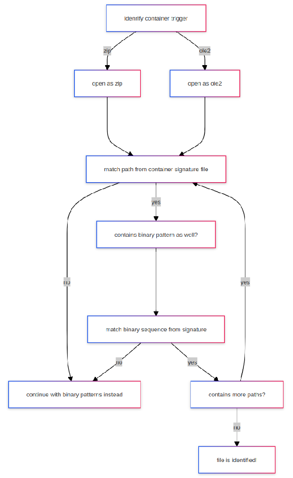

# PRONOM signature development guide

# Table of contents

- [Introduction](#introduction)
- [Syntax](#syntax)
- [PRONOM syntax](#pronom-syntax)
- [PRONOM positions](#pronom-positions)
  - [Position examples](#position-examples)
- [PRONOM semantics](#pronom-semantics)
- [PRONOM signature files](#pronom-signature-files)
  - [Standard signature files](#standard-signature-files)
  - [Container signature files](#container-signature-files)
- [Templates for DROID](#templates-for-droid)
  - [Standard signature files](#standard-signature-files)
  - [Container signature files](#container-signature-files)
- [Worked examples](#worked-examples)
  - [Standard signature example](#standard-signature-example)
  - [Container signature example](#container-signature-example)
- [Use in DROID](#use-in-droid)
- [Use in ROY](#use-in-roy)
- [Signature development utility](#signature-development-utility)
- [Cheatsheet](#cheatsheet)
- [Glossary](#glossary)
- [What next?](#what-next)
- [Credits](#credits)
- [Informative references](#informative-references)
- [Unused](#unused)

<!-- via: https://luciopaiva.com/markdown-toc/ -->

## Introduction

Research into how to research and determine PRONOM style file format
signatures, for specific file formats, is an entire topic best covered by
other resources such as the [PRONOM Starter Pack][starter-1] and the recent
Carpentries Workshop ["Searching for a Signature"][searching-1].

Signatures, however, all need to be structured using the same rules, and
once created, they are stored in PRONOM, but then serialized to disk, for
use by tools such as DROID, Siegfried, and FIDO, into "signature files"; of
which there are two types, standard (or binary), and container.

_But what are the fundamental details about how to construct a signature
and a signature file? What does a signature, or either of the
signature files, look like?_

This document provides a low-level guide cribbed from various other resources;
see [informative references](#informative-references), that should help
you understand how to build both types of DROID signature files,
i.e., standard and container.

Once you know the fundamentals of a signature and how to create a
signature file, you can begin to think about creating your own tooling
to generate and store file format signatures for your own purposes.

[starter-1]: https://github.com/digital-preservation/PRONOM_Research/blob/main/Resources/Starter_Pack.md
[searching-1]: https://ffdev-info.github.io/searching-for-a-signature/

## Background

PRONOM has two types of file format signature, and file format signature
file:

* Standard (or binary) signatures.
* Container signatures.

Standard signatures can be used on all file types, be that text, binary,
"container," or everything in between; basically, anything a computer
looks at as a file. They are used to identify consistent patterns of
byte sequences in those files and then match them against metadata
records describing specific file formats.

Container signatures are more specialized, and if something is a
container file type, such as ZIP, OLE2, or GZip, they can describe
a set of rules for interrogating the files and directories within those
containers and optionally matching them against a standard signature,
and then a metadata record describing a specific file format.

We will look at both types of signatures below and describe how to
construct them. Before that, we must talk about something called syntax.

## Syntax

Syntax is described in the written language as the set of rules that describe
how words and phrases are arranged to make well-formed sentences. Syntax is
one of the foundations of language and one of the keys to being able to express
oneself well.

In programming, syntax describes the way words and symbols are structured and
arranged to create functioning software. Similar to the written language,
programming syntax enables developers to express themselves in code and create
increasingly complex and nuanced pieces of software.

PRONOM uses a language which has a syntax. This syntax describes "file format
sequences" and the syntax is limited to a strict definition. The syntax is a
form of regular expression (regex) which is a method for identifying patterns.

## Semantics

When _syntax_ is combined in written language, code, or in PRONOM, the result
is a structured set of words and symbols that take on _semantic_ meaning,
that is, you can read the combination of symbols and determine what they
describe or what they mean. In language the result might be a poem.
In PRONOM, the result is a set of instructions for identifying runs of
bytes at calculable positions in a file that must or must not exist.
If everything matches, we can say...

| *"* | *This file conforms to what is described in this signature's syntax. As such, this file is of the type described by this signature.* |
| ----: | :---- |

We refer to PRONOM's syntax and PRONOM's semantics as a file format signature,
and this is interchangeable with the term PRONOM regular expression, or
PRONOM regex.

## PRONOM syntax

PRONOM has the following syntax.

| Syntax element | Intended use | Example |
| ----- | ----- | ----- |
| Literal sequence | Just a plain signature sequence that appears as-is | A1B2C3D4 |
| Infinite wildcard: * | The following sequence will appear at any point further in the file | A1B2C3D4*E5F6A7B8 |
| Precise wildcard: {n} | The following sequence will appear after exactly the number of bytes specified | A1B2C3D4{4}E5F6A7B8 |
| Wildcard range: {m-n} | The following sequence will appear at some point between the number of bytes specified | A1B2C3D4{4-8}E5F6A7B8 |
| Either/Or: (a\|b) | The following sequence will be any of the sequences specified. Any number of sequences can be specified | A1B2C3D4(0D|0A|0D0A)E5 |
| Byte range \[a:b\] | The next byte will be within the range specified | A1B2C3D4\[A4:B0\]E5 |
| NOT sequence: \[\!a\] | The following byte value is not this byte | A1B2C3D4\[\!E5\]F6 |
| Wildcard with infinite range: {m-*} | The following sequence will appear minimally after the first value specified, but otherwise anywhere else in the file | A1B2C3D4{4-*}E5F6A7B8 |
| Single wildcard: ?? | The following byte may have any value. This is functionally equivalent to {1} | A1B2C3D4??E5F6A7B8 |
| NOT Byte range \[\!a:b\] | The next byte will not be within the range specified | A1B2C3D4\[\!A4:B0\]E5 |

## PRONOM positions

PRONOM signatures work from an offset at one of three positions:

* BOF: Beginning Of File - the signature sequence starts at, or near the
beginning of the file
* EOF: End Of File - the signature sequence starts at, or near the end
of the file
* Var: Variable - the signature sequence may be found anywhere within the file
* Offset - the position, relative to the BOF, or EOF, where the sequence
begins. 0 is default, meaning no offset. Since an offset of 0 means
‘starting from the first byte’, an offset of 4 means ‘starting from the
5th byte’, or ‘after the 4th byte’
* Maximum Offset \- A further offset, relative to the initial Offset value
described above. The default is 0, meaning no further possible offset.

### Position examples

As an illustration, different positions and offsets can be read as follows:

* BOF, Offset 0, Maximum offset 0: The signature sequence starts at the very
beginning of the file
* BOF, Offset 4, Maximum offset 0: The signature sequence starts at exactly
position 0x04, the 5th byte
* BOF, Offset 0, Maximum offset 4: The signature sequence may start anywhere
within the first 5 bytes
* BOF, Offset 4, Maximum Offset 4: The signature sequence may start anywhere
from byte 5 through to byte 9
* EOF, Offset 4, Maximum Offset 0: The signature sequence ends exactly 4 bytes
from the end of the file
* EOF, Offset 4, Maximum Offset 4: The signature sequence may end anywhere
from 4 bytes to 8 bytes from the end of the file

> Syntax can also be used to describe offsets, e.g. using a precise
wildcard `{n}` or wildcard range: `{n-m}`:

| Syntax element | Intended use | Example |
| ----- | ----- | ----- |
| Wildcards at a beginning of a BOF sequence, or end of an EOF sequence | This is functionally equivalent to specifying Offset/Maximum Offset, however this is not recommended | {4}A1B2C3D4 or: {0-4}A1B2C3D4 |

## PRONOM semantics

As previously mentioned, PRONOM syntax is combined to create meaning.
That meaning is a set of instructions for identifying patterns of bytes that
must or must not exist in a file. If those patterns match, and they
are mapped correctly to a metadata record describing those patterns, we
can say those patterns belong to the thing described by the record, i.e.
a file format.

PRONOM signatures can be combined any way whatsoever. Usually they
will contain a literal sequence that always exists in a file, e.g. file (a)
might always begin with the text "DESKTOP PUBLISHING". Variable
sequences, or runs of unknown bytes are encoded in a PRONOM signature
using _wildcards_, e.g. file (a) might also contain a date, followed by more
known data "DESKTOP PUBLISHING <DATE WILDCARD> BY ACME".

PRONOM signatures can become highly expressive and are capable of
describing the structure of file formats with considerable precision.

Once PRONOM signatures are combined, we can begin to interpret their
semantics. A few basic examples are provided below:

| Bytestream | Sequence | Plain-language description |
| :---- | :---- | :---- |
| 00 | {n} | ... |
| 00 | {n} | ... |
| 00 | {n} | ... |

## PRONOM signature files

PRONOM signature files are currently described in
[Extensible Markup Language (XML)][xml-1]. While you might not write
XML yourself, or even look at it very often, knowing how the file
is structured helps you to debug issues and helps developers with the
process of creating software that implements these as standards.

[xml-1]: https://en.wikipedia.org/wiki/XML

### XML

[w3schools][w3schools-xml-1] provides a simple and effective introduction
to XML.

In the text below we will keep it simple, but refer to some aspects:

* Elements, surrounded by angle `<, >` brackets. are the primary structural
components of an XML file. There is always a single top-level element, a
_container_, and within that container are more pairs of elements
which can be nested, or not nested, depending on what is being described.
All elements have a label and come in pairs that open and close them.
Closing is done with a forward slash, so to open and close an element
with the label "tag", we would write: `<tag>content</tag>`.
* Attributes, are properties of elements, and appear in opening elements
only, e.g. `<tag attribute="i am an attribute">`.
* Values, are the contents of elements. Elements can contain other elements,
these are called leaves or children. Elements can also contain
alphanumeric characters depending on what is being modeled, e.g.
`<tag>these alphanumeric characters mean something</tag>`.

[w3schools-xml-1]: https://www.w3schools.com/xml/

### Standard signature files

A signature file's container element is `<FFSignatureFile>`. Two further
elements are used within a `<FFSignatureFile>` as containers that section
the file into file format signatures, and then the metadata about those
file format signatures, i.e. a mapping of metadata to the file format
signature.

The following table describes the rest of the XML file in more detail.

| Type    | Name                          | Relations                              | Cardinality                                                                                                                                                                                       |                        |
|---------|-------------------------------|----------------------------------------|---------------------------------------------------------------------------------------------------------------------------------------------------------------------------------------------------|------------------------|
| Element | `InternalSignatureCollection` | Child of **`FFSignatureFile`**         | A collection of standard signatures as described in PRONOM                                                                                                                                        | Cardinality: 1         |
| Element | `InternalSignature`           | Child of `InternalSignatureCollection` | Describes sets of sequences specific to a PRONOM record and describes an internal ID to enable a mapping between `InternalSignature` and `FileFormat`                                             | Cardinality: 1 to many |
| Element | `FileFormatCollection`        | Child of **`FFSignatureFile`**         | A collection of descriptive metadata blocks, for each PUID described in PRONOM that also has a file format extension or a standard signature                                                      | Cardinality: 1         |
| Element | `FileFormat`                  | Child of `FileFormatCollection`        | Describes format name, PUID, extension. Child elements map this format record to an `InternalSignature`; optionally lists priorities over or under another identifier to prevent falst-positives. | Cardinality: 1 to many |

In XML this looks as follows:

> **NB.** XML comments are used to provide further description.

```xml
<?xml version="1.0" encoding="UTF-8"?>
<!-- Signature file namespace and metadata is important but none so more as
     the version here which helps DROID to list signature files in its
     graphical user interface.
-->
<FFSignatureFile xmlns="http://www.nationalarchives.gov.uk/pronom/SignatureFile" Version="1788527087" DateCreated="2026-09-03T12:22:45">
  <!-- Section 1: InternalSignatureCollection contains 1..* internal signatures
       associated with a file format.
  -->
  <InternalSignatureCollection>
    <InternalSignature ID="1">
      <ByteSequence Reference="BOFoffset" Sequence="" MinOffset="" MaxOffset=""/>
      <ByteSequence Reference="BOFoffset" Sequence="" MinOffset="" MaxOffset=""/>
    </InternalSignature>
    <InternalSignature ID="2">
      <ByteSequence Reference="BOFoffset" Sequence="" MinOffset="" MaxOffset=""/>
      <ByteSequence Reference="BOFoffset" Sequence="" MinOffset="" MaxOffset=""/>
    </InternalSignature>
    <InternalSignature ID="3">
      <ByteSequence Reference="BOFoffset" Sequence="" MinOffset="" MaxOffset=""/>
    </InternalSignature>
  </InternalSignatureCollection>
  <!-- Section 2: FileFormatCollection contains 1..* file format metadata
       sections and mappings to internal signatures with priorities, and
       file format extensions.
  -->
  <FileFormatCollection>
    <FileFormat ID="1" Name="FILE FORMAT NAME" PUID="CUSTOM/PUID" Version="V0" MIMEType="application/octet-stream">
      <InternalSignatureID>1</InternalSignatureID>
      <InternalSignatureID>2</InternalSignatureID>
      <Extension>ext</Extension>
    </FileFormat>
    <FileFormat ID="3" Name="FILE FORMAT NAME" PUID="CUSTOM/PUID" Version="V1" MIMEType="application/octet-stream">
      <InternalSignatureID>3</InternalSignatureID>
      <Extension>ext</Extension>
      <!-- A priority means that this record is selected by DROID if a file
           is also moatched to one it has a priority over.
      -->
      <HasPriorityOverFileFormatID>1</HasPriorityOverFileFormatID>
    </FileFormat>
  </FileFormatCollection>
</FFSignatureFile>
```

### Container signature files

Three primary sections within a ContainerSignatureMapping element with
some child sections with added relevance:

| Type    | Name                  | Relations                                | Cardinality                                                                                                                                                                              |                         |
|---------|-----------------------|------------------------------------------|------------------------------------------------------------------------------------------------------------------------------------------------------------------------------------------|-------------------------|
| Element | `ContainerSignatures` | Child of **`ContainerSignatureMapping`** | Describes a format, and consists of sets of files expected to be consistently found within that container type. Provides an Internal ID to link it to a PUID under File Format Mappings. | Cardinality 1 to many   |
| Element | `Description`         | Child of `ContainerSignatures`           | Short description of the container file format                                                                                                                                           | -Cardinality: 1         |
| Element | `File`                | Child of `ContainerSignatures`           | A list of file paths, and optional byte patterns specific to the file format being described.                                                                                            | Cardinality 1 to many   |
| Element | `FileFormatMappings`  | Child of **`ContainerSignatureMapping`** | A list of mappings between the ContainerSignature ID and PUID as it is found in PRONOM's signature file                                                                                  | Cardinality 1 to many   |
| Element | `FileFormatMapping`   | Child of `FileFormatMappings`            | Describes a one-to-one mapping between container signature ID and a PRONOM unique identifier                                                                                             | Cardinality one to many |
| Element | `TriggerPuids`        | Child of **`ContainerSignatureMapping`** | A list of PUIDs that will trigger an attempted container identification in DROID                                                                                                         | Cardinality 1 to many   |
| Element | `TriggerPUID`         | Child of `TriggerPuids`                  | Lists the PUIDs that will trigger container identification from DROID                                                                                                                    | Cardinality one to many |

In XML this looks as follows:

> **NB.** XML comments are used to provide further description.

```xml
<?xml version="1.0" encoding="UTF-8"?>
<ContainerSignatureMapping SchemaVersion="1.0" SignatureVersion="1">
  <!-- Section 1: ContainerSignatures contains qll the information needed
       to navigate container file structures and identigy files and folders.
 -->
 <ContainerSignatures>
  <ContainerSignature Id="1" ContainerType="OLE2">
   <Description>Container description</Description>
   <Files>
    <File>
     <!-- Path can be a file, or a directory (directories must be terminated
          with a forward slash `/`
     -->
     <Path>path/to/file</Path>
     <!-- Each file can be matched using DROID's primary standard signature
          mechanism. We do this here.
     -->
     <BinarySignatures>
      <InternalSignatureCollection>
       <InternalSignature ID="1">
        <ByteSequence Reference="BOFoffset" Sequence="" MinOffset="" MaxOffset="" />
       </InternalSignature>
      </InternalSignatureCollection>
     </BinarySignatures>
    </File>
   </Files>
  </ContainerSignature>
 </ContainerSignatures>
  <!-- Section 2: FileFormatMapping maps signatures above to a PRONOM
       unique identifier (PUID).
 -->
 <FileFormatMappings>
  <FileFormatMapping signatureId="1" Puid="dev/1"></FileFormatMapping>
 </FileFormatMappings>
  <!-- Section 3: Describes PUIDs that are matched by DROID to trigger
       container level identification.
 -->
 <TriggerPuids>
  <TriggerPuid ContainerType="OLE2" Puid="fmt/111"></TriggerPuid>
  <TriggerPuid ContainerType="ZIP" Puid="fmt/189"></TriggerPuid>
  <TriggerPuid ContainerType="ZIP" Puid="x-fmt/263"></TriggerPuid>
 </TriggerPuids>
</ContainerSignatureMapping>
```

## Templates for DROID

### Standard signature files

```xml
<?xml version="1.0" encoding="UTF-8"?>
<!-- Remember to increment the version number, e.g. use a UNIX Timestamp -->
<FFSignatureFile xmlns="http://www.nationalarchives.gov.uk/pronom/SignatureFile" Version="1788527087" DateCreated="2026-09-03T12:22:45">
 <InternalSignatureCollection>
  <InternalSignature ID="4" Specificity="Specific">
   <ByteSequence Reference="BOFoffset" Sequence="FFFFFF" MinOffset="0" MaxOffset="0" />
   <!-- OPTIONAL: Additional sequences -->
   <ByteSequence Reference="EOFoffset" Sequence="FFFFFF" MinOffset="0" MaxOffset="0" />
  </InternalSignature>
 </InternalSignatureCollection>
 <FileFormatCollection>
  <!-- YOUR SIGNATURE'S METADATA GOES BELOW HERE -->
  <!-- YOUR SIGNATURE'S METADATA GOES BELOW HERE -->
  <!-- YOUR SIGNATURE'S METADATA GOES BELOW HERE -->
  <FileFormat ID="1" Name="Development Signature Template" PUID="dev/1" Version="1.0" MIMEType="application/octet-stream">
   <Extension>ext</Extension>
  </FileFormat>
 </FileFormatCollection>
</FFSignatureFile>
```

### Container signature files

Container signatures require both a container signature file, and a baseline
standard signature file.

```xml
<?xml version="1.0" encoding="UTF-8"?>
<ContainerSignatureMapping SchemaVersion="1.0" SignatureVersion="1">
 <ContainerSignatures>
  <ContainerSignature Id="1" ContainerType="OLE2">
   <Description>Container description</Description>
   <Files>
    <File>
     <Path>path/to/file</Path>
     <BinarySignatures>
      <InternalSignatureCollection>
       <InternalSignature ID="1">
        <ByteSequence Reference="BOFoffset">
         <SubSequence Position="1" SubSeqMinOffset="0" SubSeqMaxOffset="0">
          <Sequence>1122</Sequence>
         </SubSequence>
        </ByteSequence>
       </InternalSignature>
      </InternalSignatureCollection>
     </BinarySignatures>
    </File>
   </Files>
  </ContainerSignature>
 </ContainerSignatures>
 <FileFormatMappings>
  <FileFormatMapping signatureId="1" Puid="dev/1"></FileFormatMapping>
 </FileFormatMappings>
 <TriggerPuids>
  <TriggerPuid ContainerType="OLE2" Puid="fmt/111"></TriggerPuid>
  <TriggerPuid ContainerType="ZIP" Puid="fmt/189"></TriggerPuid>
  <TriggerPuid ContainerType="ZIP" Puid="x-fmt/263"></TriggerPuid>
 </TriggerPuids>
</ContainerSignatureMapping>
```

#### Standard signature file for container identification

```xml
<?xml version="1.0" encoding="UTF-8"?>
<FFSignatureFile xmlns="http://www.nationalarchives.gov.uk/pronom/SignatureFile" Version="1788527087" DateCreated="2026-09-03T12:22:45">
 <InternalSignatureCollection>
  <InternalSignature ID="2" Specificity="Specific">
   <ByteSequence Reference="BOFoffset" Sequence="504B0304" MinOffset="0" MaxOffset="4" />
   <ByteSequence Reference="EOFoffset" Sequence="504B01" MinOffset="61" MaxOffset="65565" />
   <ByteSequence Reference="EOFoffset" Sequence="504B0506" MinOffset="0" MaxOffset="65535" />
  </InternalSignature>
  <InternalSignature ID="3" Specificity="Specific">
   <ByteSequence Reference="BOFoffset" Sequence="504B0304" MinOffset="0" MaxOffset="0" />
   <ByteSequence Reference="BOFoffset" Sequence="5B436F6E74656E745F54797065735D2E786D6C20A2" MinOffset="4" MaxOffset="30" />
   <ByteSequence Reference="EOFoffset" Sequence="504B0102" MinOffset="0" MaxOffset="65535" />
   <ByteSequence Reference="EOFoffset" Sequence="504B0506" MinOffset="0" MaxOffset="65535" />
  </InternalSignature>
  <InternalSignature ID="4" Specificity="Specific">
   <ByteSequence Reference="BOFoffset" Sequence="D0CF11E0A1B11AE1" MinOffset="0" MaxOffset="0" />
   <ByteSequence Reference="BOFoffset" Sequence="FEFF" MinOffset="0" MaxOffset="20" />
  </InternalSignature>
 </InternalSignatureCollection>
 <FileFormatCollection>
  <FileFormat ID="2" Name="ZIP Format" PUID="x-fmt/263" Version="" MIMEType="application/zip">
   <InternalSignatureID>2</InternalSignatureID>
   <Extension>zip</Extension>
  </FileFormat>
  <FileFormat ID="3" Name="Microsoft Office Open XML" PUID="fmt/189" Version="" MIMEType="application/octet-stream">
   <InternalSignatureID>3</InternalSignatureID>
  </FileFormat>
  <FileFormat ID="4" Name="OLE2 Compound Document Format" PUID="fmt/111" Version="" MIMEType="application/octet-stream">
   <InternalSignatureID>4</InternalSignatureID>
  </FileFormat>
  <!-- YOUR SIGNATURE'S METADATA GOES BELOW HERE -->
  <!-- YOUR SIGNATURE'S METADATA GOES BELOW HERE -->
  <!-- YOUR SIGNATURE'S METADATA GOES BELOW HERE -->
  <FileFormat ID="1" Name="Development Signature" PUID="dev/1" Version="1.0" MIMEType="application/octet-stream">
   <Extension>ext</Extension>
  </FileFormat>
 </FileFormatCollection>
</FFSignatureFile>
```

## Worked examples

### Standard signature example

Here is a real-world signature example taken from PRONOM:

* Position type: Absolute from BOF
* Offset: 0
* Value: `FFD8FFE0{2}4A464946000100(00|01|02)`
* Position type: Absolute from EOF
* Offset: 0
* Maximum Offset: 65536
* Value: FFD9

[fmt/42 - JPEG 1.00](https://www.nationalarchives.gov.uk/PRONOM/fmt/42)

#### Process

1. add to …
2. add to…
3.

### Container signature examples

1)

<ContainerSignature ContainerType="ZIP" Id="31030">
<Description>SIARD 2.2</Description>
<Files>
<File>
<Path>header/siardversion/2.2/</Path>
</File>
</Files>
</ContainerSignature>

2.

<ContainerSignature Id="32000" ContainerType="ZIP">
<Description>Open Raster Image Format</Description>
<Files>
<File>
<Path>mimetype</Path>
<BinarySignatures>
<InternalSignatureCollection>
<InternalSignature ID="32000">
<ByteSequence Reference="BOFoffset">
<SubSequence Position="0" SubSeqMinOffset="0" SubSeqMaxOffset="0">
<Sequence>'image/openraster'</Sequence>
</SubSequence>
</ByteSequence>
</InternalSignature>
</InternalSignatureCollection>
</BinarySignatures>
</File>
</Files>
</ContainerSignature>

#### Process

1. add to standard sig…
2. add to …
3.

## Use in DROID

DROID has two directories for signature files under the following location:

USER\_HOME/.droid6
The directories are:

signature\_files
container\_sigs

Standard signature files must be placed in signature\_files and container
signature files must be placed in container\_sigs

## Use in ROY

https://github.com/richardlehane/siegfried/wiki/Building-a-signature-file-with-ROY#pronom-signature-development

roy build extend…

## Signature development utility

The signature development utility makes it easier to create signature
files by hiding the need to write XML from you.

## Cheatsheet

#### PRONOM terms, basic syntax and data model

##### Offset markers

**BOF** \= Beginning of File.

**EOF** \= End of File. Var \= Variable (anywhere in the file)

**Offset/Max Offset** \= Exact or positional range in which a signature starts

##### Wildcards

**??** \= single wildcard byte, e.g. `AB??C3`

**\\*** \= 0-many wildcard bytes, e.g `BC*D4`

**{n}** \= specific number of wildcard bytes, e.g. `A2{5}F3`

**{n-n}** \= range of wildcard bytes, e.g. `4D{0-12}E4`

##### Byte range

**\[hh:hh\]** \= single byte value between range, e.g `[00:FA]`

##### Either/or

**(hhhh|hhhh|hh)** \= either/any or these byte values,
e.g. `(0D|0A|0D0A)`

##### Not

**\[\!hh\]** \= anything except this byte value, e.g. `ABCD[!01]E1`

## What next?

* federate
* distributed
* create
* implement


## Glossary

binary
bytes
File format identification tool, e.g. DROID Siegfried, FIDO
File format signature
gzip
literal
ole2
regex / regular expression
semantics
syntax
wildcard
zip

## Credits

* David
* Francesca
* Tyler

> NB. and everyone else who has contributed to this knowledge resource over
the years

## Informative references

* https://exponentialdecay.co.uk/blog/declarative-all-the-way-down-building-pronom-signatures-with-jsonid/

* https://openpreservation.org/blogs/droid-container-signature-files-what-they-are-and-how-to-create-them-a-template-and-an-example-or-few/

* https://ffdev-info.github.io/searching-for-a-signature/

* https://www.nationalarchives.gov.uk/aboutapps/fileformat/pdf/automatic_format_identification.pdf

* https://exponentialdecay.co.uk/blog/simpledroid-completing-the-circle/

* https://www.unixtimestamp.com/

* https://github.com/nationalarchives/pronom/issues/88#issuecomment-4421635688 <-- shows simple syntax doesn't use min max

* https://ffdev-info.github.io/searching-for-a-signature/005-pronom-syntax.html

* http://markdowntable.com/

* https://www.nationalarchives.gov.uk/aboutapps/fileformat/pdf/automatic_format_identification.pdf

<hr>

## Unused


